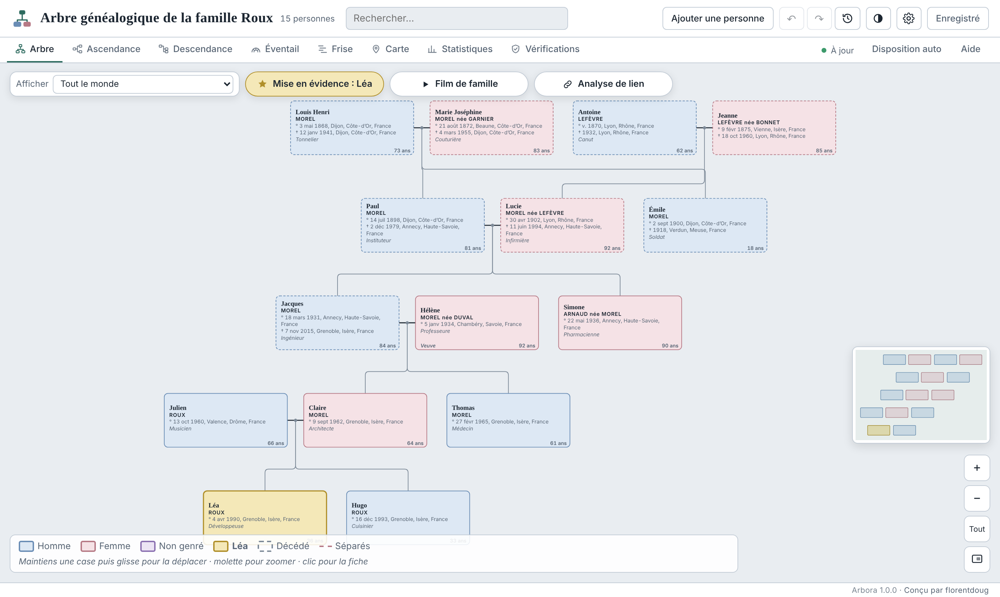
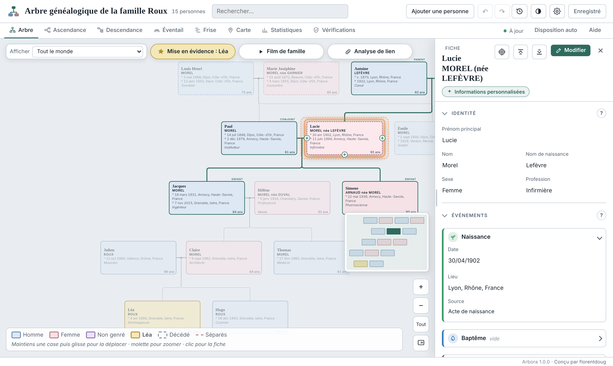
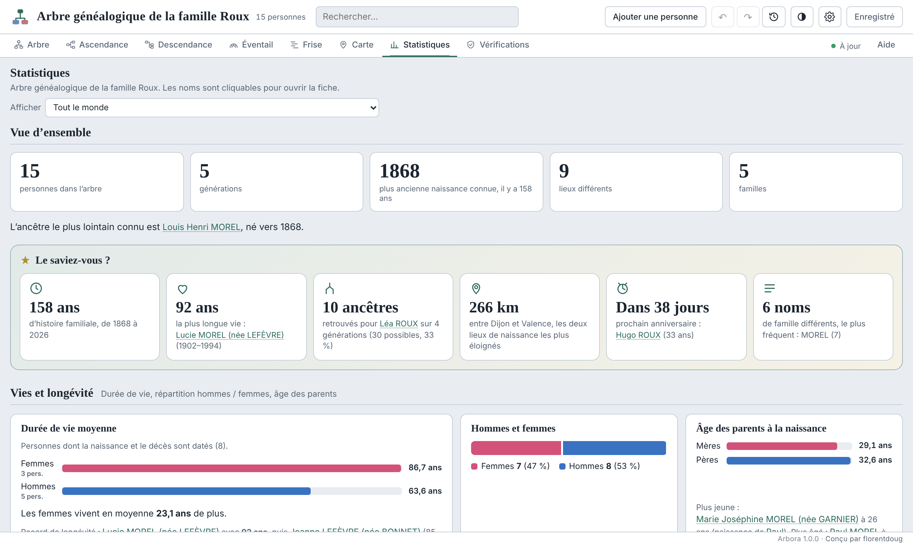
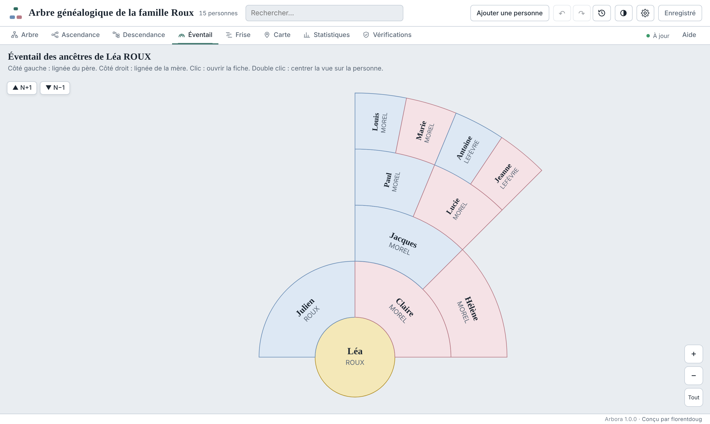

# Arbora

**Ton arbre généalogique, chez toi.** Un outil de généalogie complet qui tient dans un seul fichier HTML : il s’ouvre dans n’importe quel navigateur, fonctionne hors ligne, sans compte et sans serveur.

*Your family tree, at home. A complete genealogy tool in a single HTML file: it opens in any browser, works offline, with no account and no server. [English below](#english)*

## Télécharger

1. Va dans **[Releases](https://github.com/florentdoug/arbora/releases/latest)** et télécharge le fichier `arbora-x.y.z.html`.
2. Ouvre-le d’un double clic dans ton navigateur (Chrome, Edge, Firefox, Safari).
3. Commence par toi, importe un fichier GEDCOM (MyHeritage, Geneanet…) ou démarre avec une IA.

Pour être prévenu des nouvelles versions : bouton **Watch**, puis **Custom**, puis **Releases**. L’outil peut aussi vérifier lui-même une fois par jour (désactivable dans « À propos »).

> Sur iPhone ou iPad, l’aperçu de l’app Fichiers n’exécute pas le code : ouvre le fichier dans un navigateur.

## Pourquoi Arbora

- **100 % local** : tes données restent sur ton appareil. Aucun serveur, aucun compte, aucune base de données chez un tiers.
- **Décentralisé** : chacun garde son arbre, plutôt que de le confier à de grands centres de données.
- **Léger et partageable** : un fichier HTML et des sauvegardes JSON de quelques centaines de Ko. Formats ouverts (GEDCOM).
- **Respectueux de la vie privée** : pas de publicité, pas de pistage. Les personnes vivantes peuvent être masquées dans les copies partagées.
- **Durable** : sans installation ni abonnement, lisible dans vingt ans.

## Fonctions

- Arbre interactif à disposition automatique, fiches détaillées (lecture ou édition), unions et divorces, photos et documents.
- Vues ascendance, descendance, éventail, frise et carte, toutes filtrables.
- Statistiques avec « Le saviez-vous ? », informations personnalisées pour chaque personne, analyse de lien de parenté.
- Vérifications : dates impossibles, boucles, doublons, formats, avec des sources de recherche par pays.
- Film de famille animé (une personne, un nom, tout l’arbre), exportable en vidéo.
- Import GEDCOM et JSON avec fusion des doublons. Exports PDF, image, GEDCOM, JSON, draw.io, et copie partageable de l’outil (modifiable ou en lecture seule).
- Consignes prêtes à l’emploi pour améliorer l’arbre ou le démarrer avec une IA.
- Six langues : français, anglais, espagnol, allemand, italien, portugais. Thème clair et sombre.

| Fiche | Statistiques | Éventail |
|---|---|---|
|  |  |  |

*Les captures utilisent une famille fictive.*

## Mettre à jour

Télécharge la nouvelle version, puis dans **Paramètres, Importer**, choisis **Mettre à jour depuis une ancienne copie** et sélectionne ton ancien fichier : ton arbre est repris. Tu peux aussi importer ta dernière sauvegarde JSON.

## À savoir

L’amélioration par une IA est la seule fonction qui fait sortir tes données : envoyer ton fichier à une IA en ligne, c’est le confier à une entreprise. Le fond de carte, la recherche de lieux (OpenStreetMap) et les polices d’écriture se chargent depuis internet quand c’est possible, sans aucune donnée de l’arbre.

## Signaler un problème ou proposer une idée

Onglet **[Issues](https://github.com/florentdoug/arbora/issues/new/choose)**. Merci de ne jamais joindre de fichier contenant des données réelles de ta famille.

## Soutenir Arbora

Arbora est gratuit et le restera. Si l’outil t’est utile, tu peux offrir un café à son auteur sur **[Ko-fi](https://ko-fi.com/florentdoug)**.

## Licence

Logiciel libre sous licence **GNU GPL v3** : tu peux l’utiliser, l’étudier, le modifier et le redistribuer, à condition que les versions modifiées restent libres sous la même licence. Fourni sans garantie. Conçu par **florentdoug**.

---

## English

**Your family tree, at home.** Arbora is a complete genealogy tool in a single HTML file. Download `arbora-x.y.z.html` from **[Releases](https://github.com/florentdoug/arbora/releases/latest)**, open it in your browser, and start with yourself, import a GEDCOM file or start with an AI.

- 100 % local, no account, no server, works offline.
- Interactive tree, records, ancestry, fan chart, timeline, map, statistics, checks, family film, PDF, image, GEDCOM and JSON exports.
- Six languages, light and dark themes.
- To update: download the new version, then **Settings, Import, Update from an old copy**.
- Bugs and ideas: **[Issues](https://github.com/florentdoug/arbora/issues/new/choose)**. Never attach real family data.
- Arbora is free and will stay free. If you find it useful, you can buy its author a coffee on **[Ko-fi](https://ko-fi.com/florentdoug)**.

Free software under the **GNU GPL v3** licence, provided without warranty. Designed by **florentdoug**.
