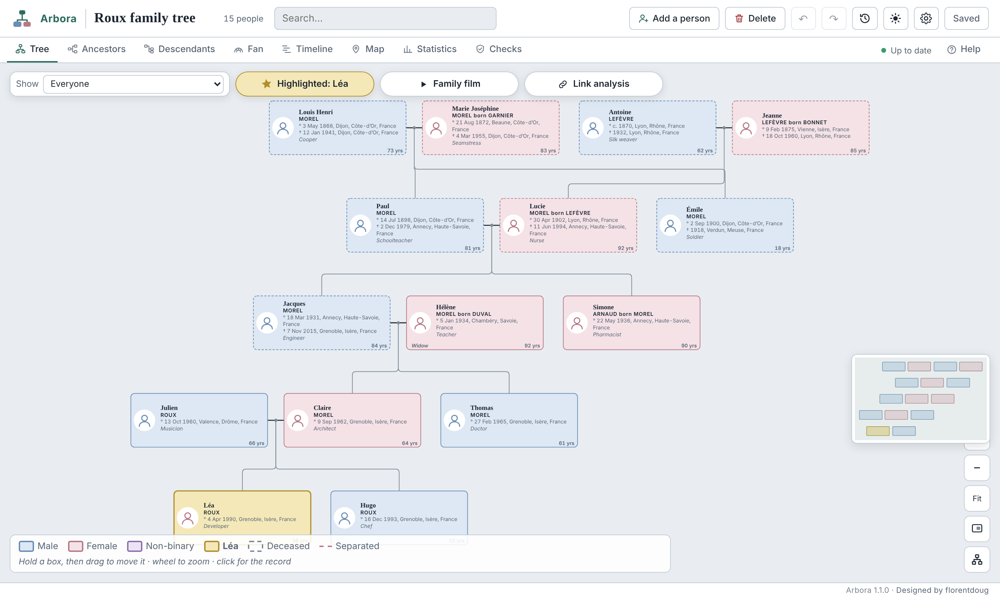
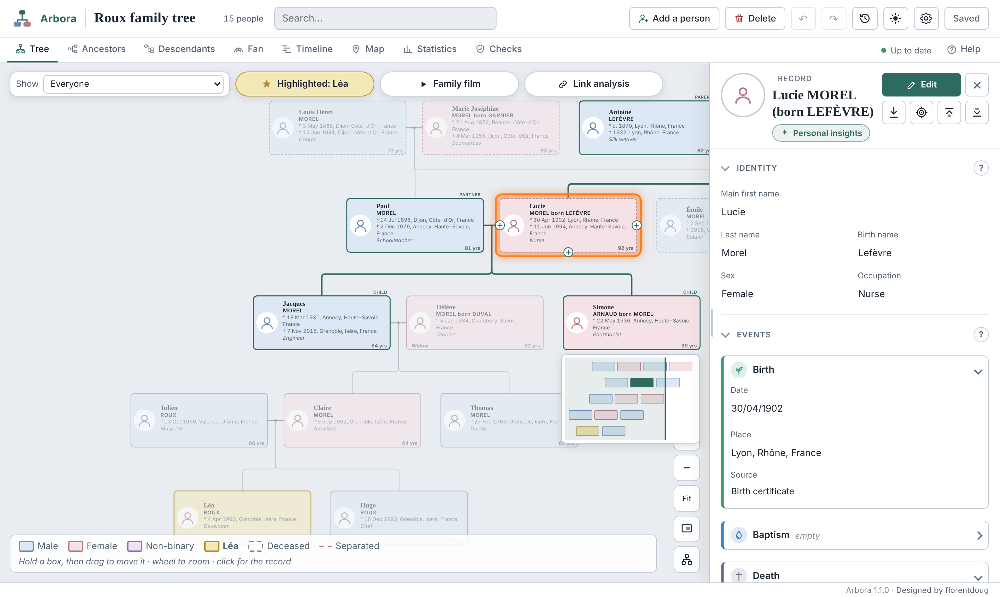
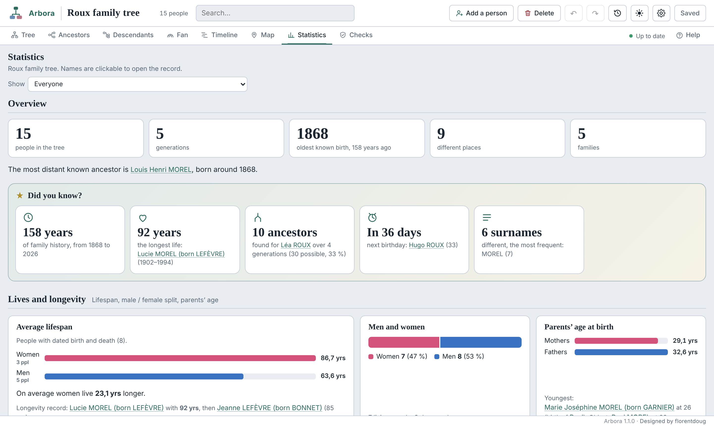
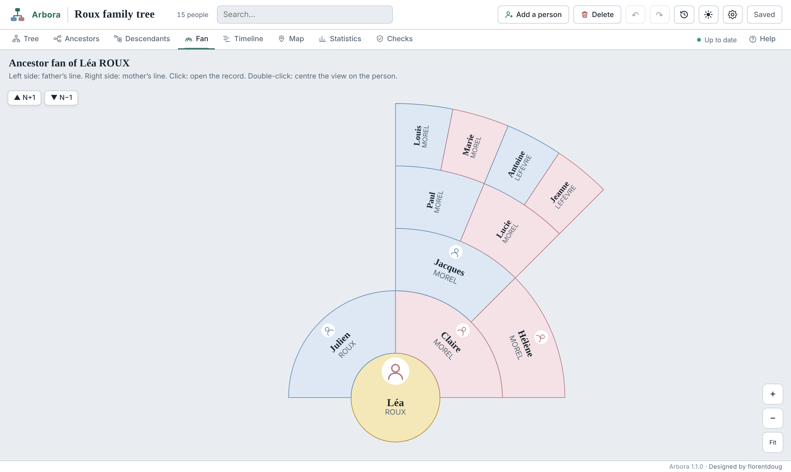
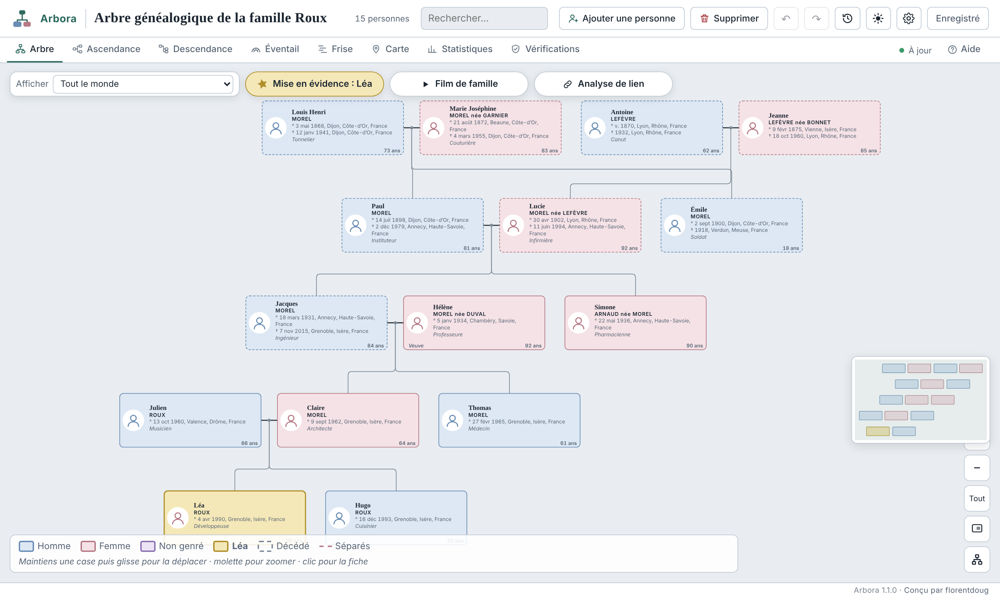
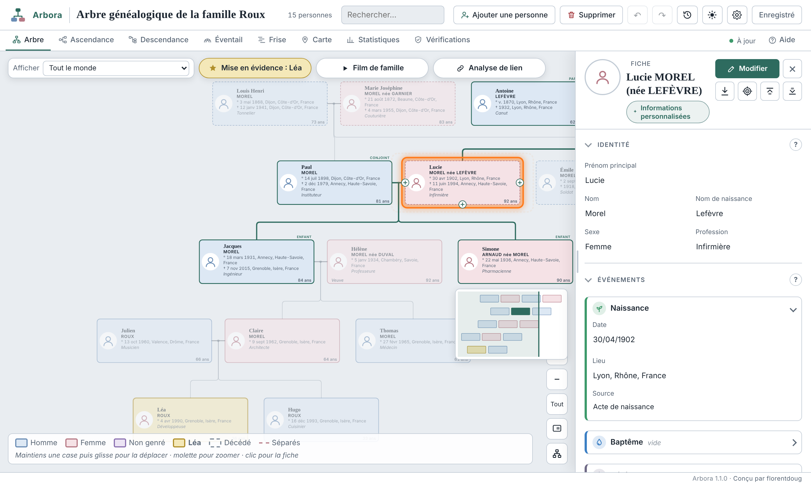
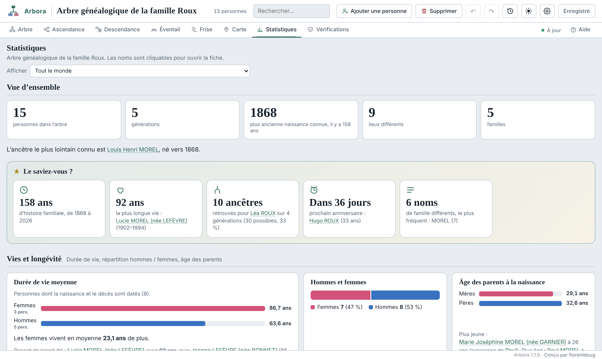
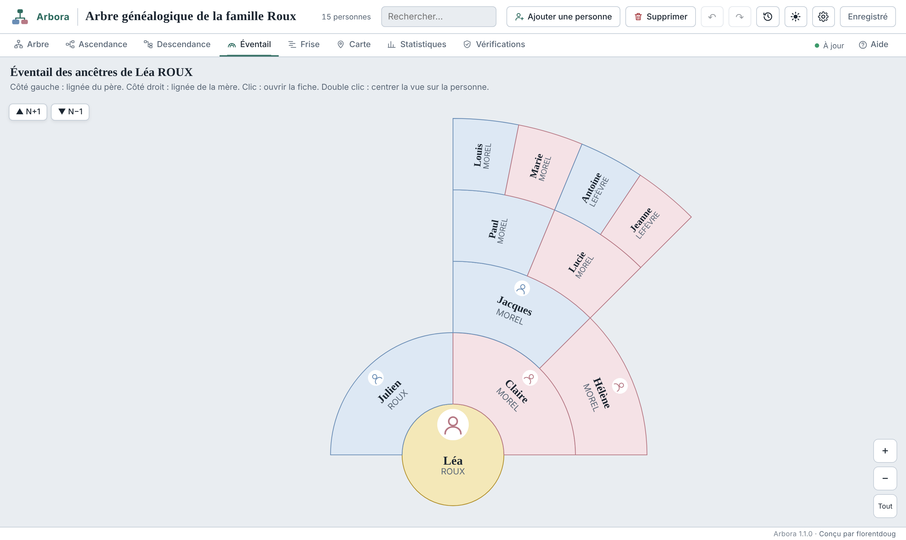

# Arbora

**English** · [Français](#français)

**Your family tree, at home.** Arbora is a complete genealogy tool in a single HTML file. It opens in any browser and works offline, with no account and no server.

## Download

1. Go to **[Releases](https://github.com/florentdoug/arbora/releases/latest)** and download the `arbora-x.y.z.html` file.
2. Double-click it to open it in your browser (Chrome, Edge, Firefox, Safari).
3. Start with yourself, import a GEDCOM file (MyHeritage, Geneanet…) or start with an AI.

To be notified of new versions: **Watch** button, then **Custom**, then **Releases**. Arbora can also check by itself once a day (can be turned off in “About”).

> On iPhone or iPad, file previews (Files, Mail, Instagram, WhatsApp) do not run the code. Use a computer, or open the file with an app that includes a browser.

## Why Arbora

- **100% local**: your data stays on your device. No server, no account, no third-party database.
- **Decentralized**: everyone keeps their own tree instead of handing it to big data centers.
- **Light and shareable**: one HTML file and JSON backups of a few hundred KB. Open formats (GEDCOM).
- **Privacy-friendly**: no ads, no tracking. Living people can be hidden in copies shared with family.
- **Durable**: no installation, no subscription, still readable in twenty years.

## Features

- Interactive tree with automatic layout, detailed records (read or edit mode), unions and divorces, photos and documents.
- Delete a person or a family with the consequences explained first. Duplicate and loop tools to clean up the tree.
- Ancestry, descendants, fan chart, timeline and map views, all filterable.
- Statistics with “Did you know?”, personal insights for each person, relationship analysis.
- Checks: impossible dates, loops, duplicates, formats, with research sources by country.
- Animated family film (one person, one surname, the whole tree), exportable as a video.
- GEDCOM and JSON import with duplicate merging. PDF, image, GEDCOM and JSON exports, plus a shareable copy of the tool (editable or read-only).
- Share a single record (JSON or PDF) or a whole family: on import, people already in the tree are recognised and the family is linked in the right place.
- Change history kept in the file, with a log you can export.
- Ready-to-use instructions to improve the tree or start it with an AI.
- Six languages: English, French, Spanish, German, Italian, Portuguese. Light and dark themes.

| Record | Statistics | Fan chart |
|---|---|---|
|  |  |  |

*Screenshots use a fictional family.*

## Updating

Download the new version, then in **Settings, Import**, choose **Update from an old copy** and select your old file: your tree is carried over. You can also import your latest JSON backup.

## Good to know

Improving the tree with an AI is the only feature that sends your data out: sending your file to an online AI means handing it to a company. The map background, place search (OpenStreetMap) and fonts load from the internet when possible, without any tree data.

## Report a problem or suggest an idea

Use the **[Issues](https://github.com/florentdoug/arbora/issues/new/choose)** tab. Please never attach a file containing real family data.

## Support Arbora

Arbora is free and will stay free. If you find it useful, you can buy its author a coffee on **[Ko-fi](https://ko-fi.com/florentdoug)**.

## License

Free software under the **GNU GPL v3** license: you can use, study, modify and share it, as long as modified versions stay free under the same license. Provided without warranty. Designed by **florentdoug**.

---

# Français

[English](#arbora) · **Français**

**Ton arbre généalogique, chez toi.** Arbora est un outil de généalogie complet qui tient dans un seul fichier HTML. Il s’ouvre dans n’importe quel navigateur et fonctionne hors ligne, sans compte et sans serveur.

## Télécharger

1. Va dans **[Releases](https://github.com/florentdoug/arbora/releases/latest)** et télécharge le fichier `arbora-x.y.z.html`.
2. Ouvre-le d’un double clic dans ton navigateur (Chrome, Edge, Firefox, Safari).
3. Commence par toi, importe un fichier GEDCOM (MyHeritage, Geneanet…) ou démarre avec une IA.

Pour être prévenu des nouvelles versions : bouton **Watch**, puis **Custom**, puis **Releases**. Arbora peut aussi vérifier lui-même une fois par jour (désactivable dans « À propos »).

> Sur iPhone ou iPad, les aperçus de fichiers (Fichiers, Mail, Instagram, WhatsApp) n’exécutent pas le code. Utilise un ordinateur, ou ouvre le fichier avec une app qui contient un navigateur.

## Pourquoi Arbora

- **100 % local** : tes données restent sur ton appareil. Aucun serveur, aucun compte, aucune base de données chez un tiers.
- **Décentralisé** : chacun garde son arbre, plutôt que de le confier à de grands centres de données.
- **Léger et partageable** : un fichier HTML et des sauvegardes JSON de quelques centaines de Ko. Formats ouverts (GEDCOM).
- **Respectueux de la vie privée** : pas de publicité, pas de pistage. Les personnes vivantes peuvent être masquées dans les copies partagées.
- **Durable** : sans installation ni abonnement, lisible dans vingt ans.

## Fonctions

- Arbre interactif à disposition automatique, fiches détaillées (lecture ou édition), unions et divorces, photos et documents.
- Suppression d’une personne ou d’une famille avec les conséquences expliquées avant. Outils de doublons et de boucles pour nettoyer l’arbre.
- Vues ascendance, descendance, éventail, frise et carte, toutes filtrables.
- Statistiques avec « Le saviez-vous ? », informations personnalisées pour chaque personne, analyse de lien de parenté.
- Vérifications : dates impossibles, boucles, doublons, formats, avec des sources de recherche par pays.
- Film de famille animé (une personne, un nom, tout l’arbre), exportable en vidéo.
- Import GEDCOM et JSON avec fusion des doublons. Exports PDF, image, GEDCOM, JSON et copie partageable de l’outil (modifiable ou en lecture seule).
- Partage d’une fiche (JSON ou PDF) ou d’une famille entière : à l’import, les personnes déjà présentes sont reconnues et la famille se rattache au bon endroit.
- Historique des modifications gardé dans le fichier, avec un journal exportable.
- Consignes prêtes à l’emploi pour améliorer l’arbre ou le démarrer avec une IA.
- Six langues : français, anglais, espagnol, allemand, italien, portugais. Thème clair et sombre.

| Fiche | Statistiques | Éventail |
|---|---|---|
|  |  |  |

*Les captures utilisent une famille fictive.*

## Mettre à jour

Télécharge la nouvelle version, puis dans **Paramètres, Importer**, choisis **Mettre à jour depuis une ancienne copie** et sélectionne ton ancien fichier : ton arbre est repris. Tu peux aussi importer ta dernière sauvegarde JSON.

## À savoir

L’amélioration par une IA est la seule fonction qui fait sortir tes données : envoyer ton fichier à une IA en ligne, c’est le confier à une entreprise. Le fond de carte, la recherche de lieux (OpenStreetMap) et les polices d’écriture se chargent depuis internet quand c’est possible, sans aucune donnée de l’arbre.

## Signaler un problème ou proposer une idée

Onglet **[Issues](https://github.com/florentdoug/arbora/issues/new/choose)**. Merci de ne jamais joindre de fichier contenant des données réelles de ta famille.

## Soutenir Arbora

Arbora est gratuit et le restera. Si l’outil t’est utile, tu peux offrir un café à son auteur sur **[Ko-fi](https://ko-fi.com/florentdoug)**.

## Licence

Logiciel libre sous licence **GNU GPL v3** : tu peux l’utiliser, l’étudier, le modifier et le redistribuer, à condition que les versions modifiées restent libres sous la même licence. Fourni sans garantie. Conçu par **florentdoug**.
