

  <picture>
    <source media="(prefers-color-scheme: dark)" srcset="docs/logo-dark.svg">
    
  </picture>

<h3 align="center">Your family tree, at home.</h3>

  A complete genealogy tool in a single HTML file. 
  No account, no server, no installation. It even works offline.

  
  
  
  

  <b>English</b> · <a href="#français">Français</a>

  

  <a href="https://florentdoug.github.io/arbora/demo.html"><b>Try the online demo</b></a> · <a href="https://florentdoug.github.io/arbora/">Website</a> · <a href="https://github.com/florentdoug/arbora/releases">All versions</a>

<table>
  <tr><th>Light</th><th>Dark</th></tr>
  <tr>
    <td>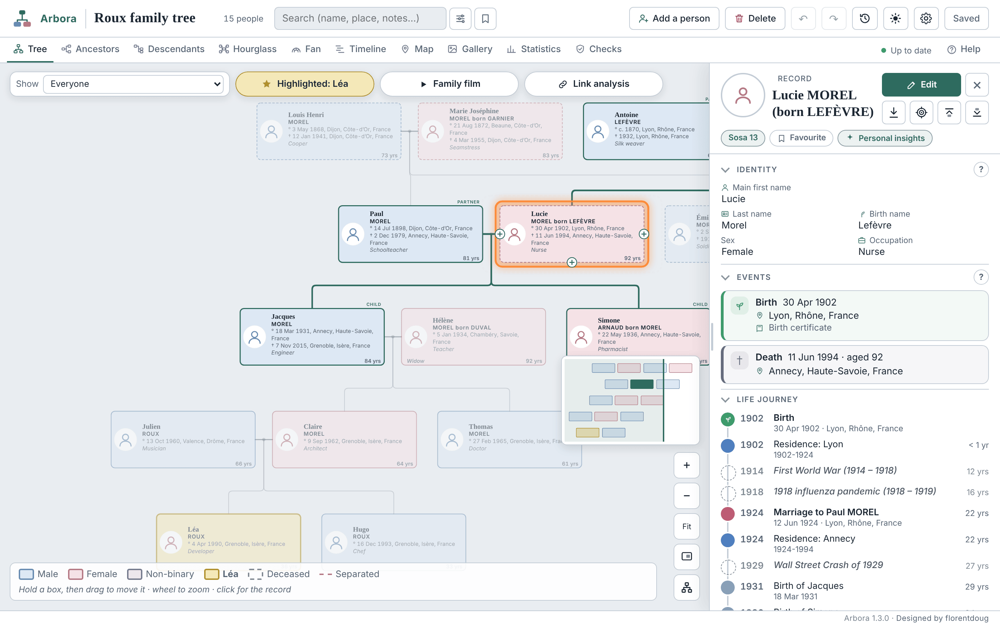</td>
    <td>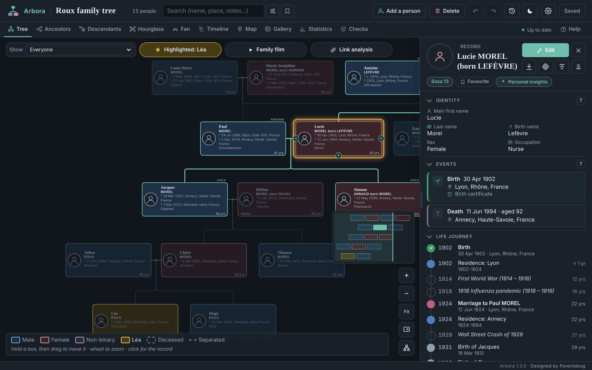</td>
  </tr>
</table>

## Get started in one minute

1. **Download** `arbora.html` with the button above.
2. **Open** it with a double click, in Chrome, Edge, Firefox or Safari.
3. **Start** with yourself, import a GEDCOM file (MyHeritage, Geneanet…), start with an AI, or explore the **example tree** first.

Your tree lives inside the file: save it, back it up, send it to your family. Arbora tells you when a new version is out and **updates itself while keeping your tree**.

> On iPhone or iPad, file previews (Files, Mail, WhatsApp) do not run the code. Use a computer, or the online demo.

## Why Arbora

- **Your data stays with you.** Nothing is sent to a server. No ads, no tracking, and you can protect the file with a password.
- **Everything in one file.** The tool, the tree, the photos and the documents, in about 1 MB plus your images.
- **Complete.** Tree, record, hourglass, fan chart, timeline, map, gallery, statistics, checks, family book as PDF.
- **Open.** GEDCOM and JSON import and export, six languages, light and dark themes. Your tree is never locked in.
- **Durable.** No subscription, no installation. The file will still open in twenty years.

## New in 1.5.0

- **Smoother wheel zoom** and faster Map.
- **Guided tour redone for beginners** and a new welcome screen.
- **Checks redesigned** with « Quick wins » and progress per category.
- **Residences with start and end years**, sorted in one click.
- **AI**: research the history of a surname, with deep research advice.
- **Export redesigned**, gallery preview, guided switch after an update.

## New in 1.4.0

- **One person's journey on the map**, with numbered steps.
- **Reorder residences** by dragging them in the record.
- **Guided updates**: the current file can be replaced directly, or a window explains how to switch to the new one.
- **Sosa numbering** can be hidden everywhere, **About** redesigned, round and large photos by default.

## New in 1.3.0

- **Hourglass view**: the ancestors on the left and the descendants on the right of one person.
- **Gallery** of all photos and documents, with a contact sheet as PDF.
- **Witnesses and godparents**, **adoption and foster links**.
- **Search across all content**, **favourites**, **CSV import**, **French Republican calendar**, **historical landmarks**.
- **Customisable record PDF**: 8 palettes, 3 layouts, modern or classic font, and the content of your choice.
- **Checks that guide you** from one remark to the next, with « Why? » on each.
- **Example tree** to try everything risk-free, **lighten images** with a real before and after preview.
- **A file half the size**: about 1 MB instead of 2.1 MB, with nothing removed.

Full details in the [CHANGELOG](CHANGELOG.md).

## In pictures

<table>
  <tr><th width="50%">Light</th><th width="50%">Dark</th></tr>
  <tr><td colspan="2"><b>Hourglass</b>: ancestors and descendants of one person</td></tr>
  <tr><td>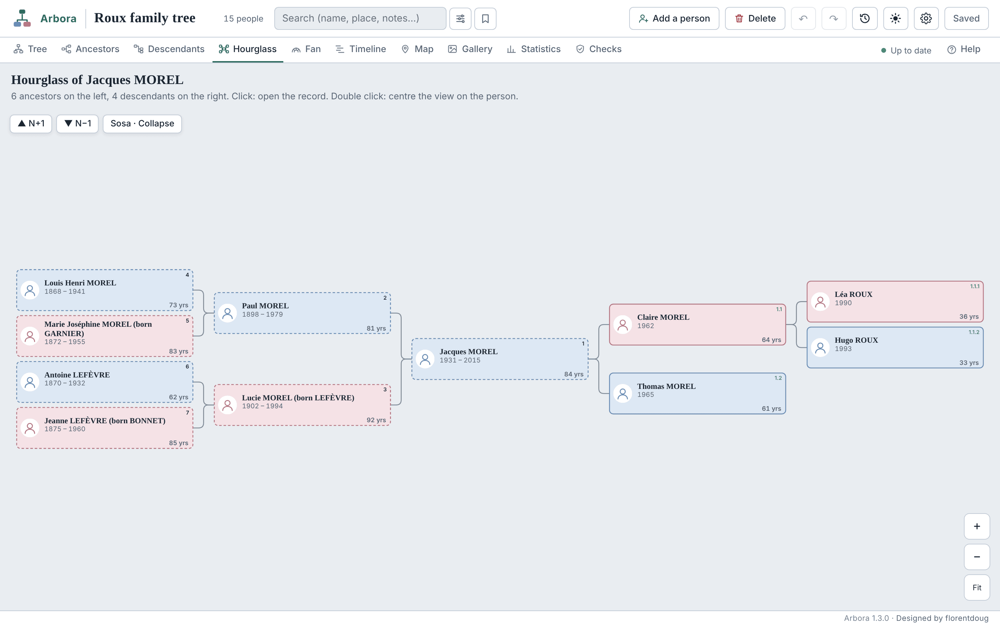</td><td>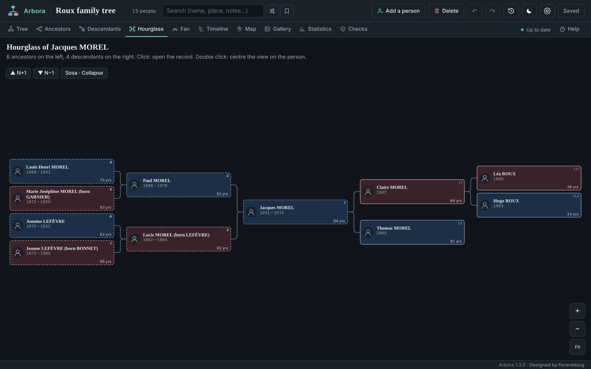</td></tr>
  <tr><td colspan="2"><b>Fan chart</b> of ancestors</td></tr>
  <tr><td>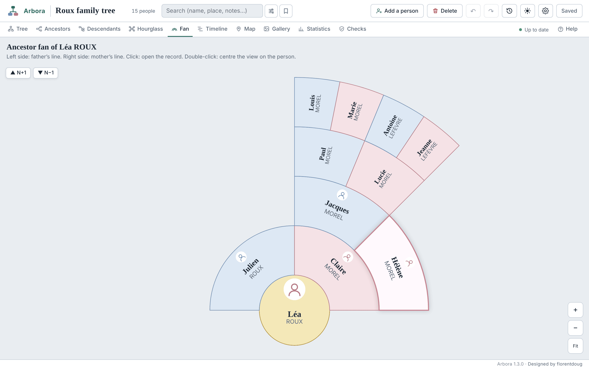</td><td>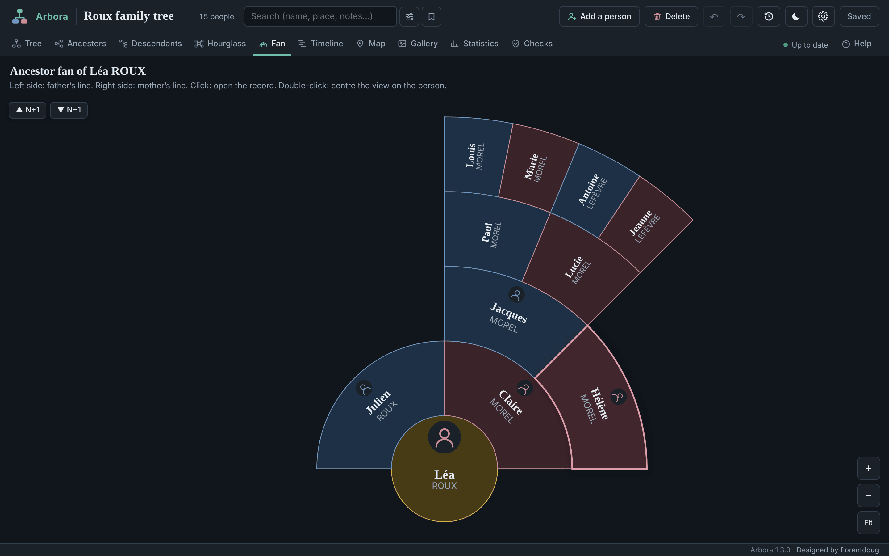</td></tr>
  <tr><td colspan="2"><b>Statistics</b>, records and curiosities</td></tr>
  <tr><td>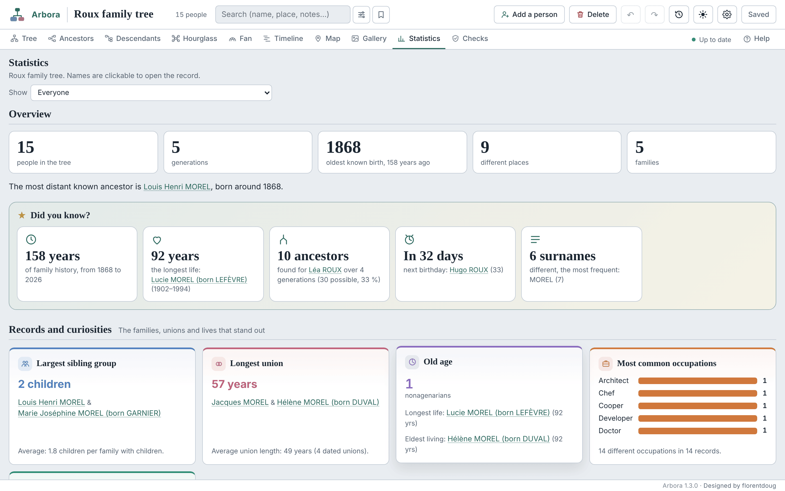</td><td>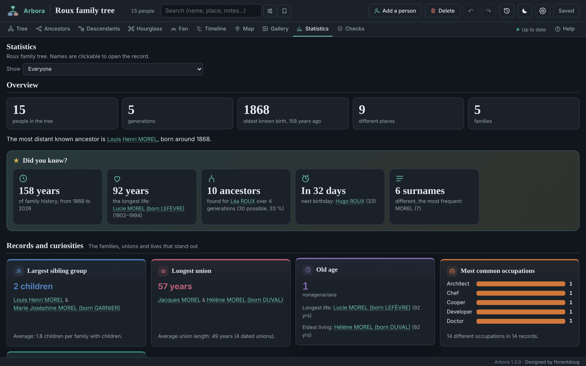</td></tr>
  <tr><td colspan="2"><b>Timeline</b> of lives</td></tr>
  <tr><td>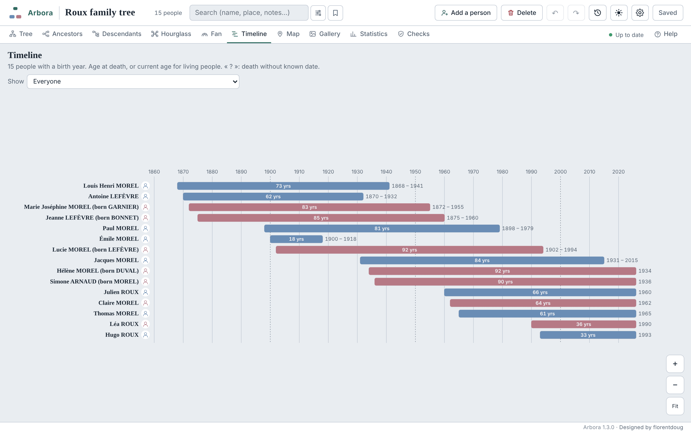</td><td>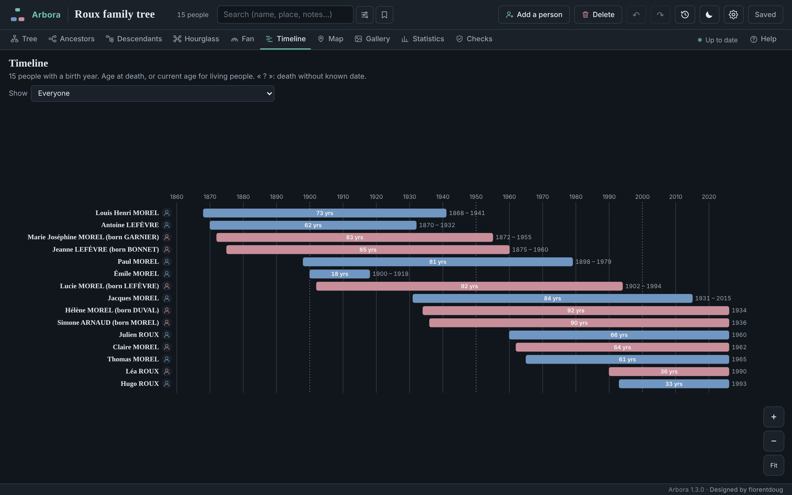</td></tr>
  <tr><td colspan="2"><b>Record as PDF</b>, customisable</td></tr>
  <tr><td>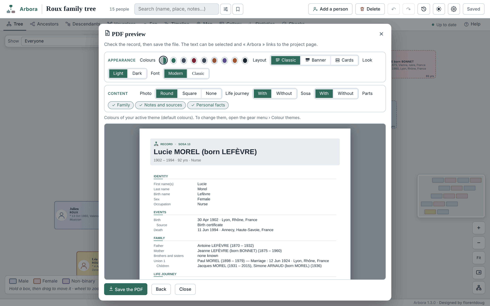</td><td>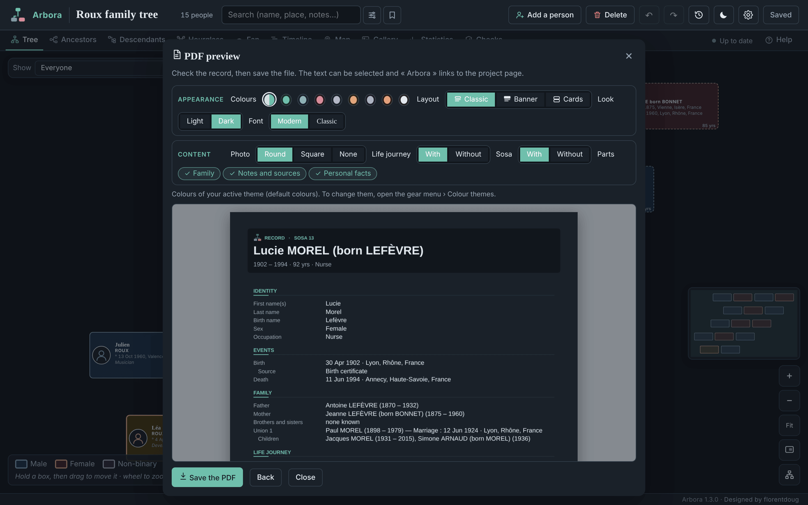</td></tr>
</table>

Screenshots use a fictional family.

## All features

<b>See the full list</b>

- Interactive tree with automatic layout, detailed records (read or edit mode) with field icons, unions and divorces, photos and documents, life photos.
- Ancestors, descendants, hourglass (with d’Aboville numbering), fan chart, timeline, map and gallery views.
- Life journey per person (job, studies, moves…) with the age at each step and optional historical landmarks.
- Structured sources with reliability, witnesses and godparents, adoption and foster links.
- Sosa numbering, shared ancestors and completeness per generation.
- Statistics with « Did you know? », records and curiosities, a portrait for each filter, personal insights, relationship analysis.
- Checks: impossible dates, loops, duplicates, formats, places to harmonise, research leads by country, progress over time.
- Family book as PDF, customisable one-page record PDF, gallery contact sheet, image and GEDCOM exports.
- Animated family film, exportable as a video.
- GEDCOM, JSON and CSV import, with a clear choice between merging and replacing, and duplicate merging.
- Share a record or a whole family: on import, people already in the tree are recognised.
- Shareable copy of the tool (editable or read-only), living people can be hidden.
- Password protection, change history kept in the file, exportable log.
- Family calendar (.ics), « Today in the family » reminder, favourites, advanced search, keyboard shortcuts (`?` key).
- Map with life journeys and one-click refresh of all places.
- Image lightening with a real preview and sending limits (email, Discord).
- Ready-to-use instructions to improve the tree or start it with an AI.
- Six languages: English, French, Spanish, German, Italian, Portuguese. Light and dark themes, colour themes.

## Updating

The update banner offers **Update and keep my tree**: Arbora downloads the new version, puts your tree in it and replaces your file (Chrome, Edge, Brave) or saves a new one and guides you to it. Otherwise, download the new version, then in **Settings, Import**, choose **Update from an old copy**. You can also import your latest JSON backup.

## Good to know

Improving the tree with an AI is the only feature that sends your data out: sending your file to an online AI means handing it to a company. The map background, place search (OpenStreetMap) and fonts load from the internet when possible, without any tree data.

## Report a problem or suggest an idea

Use the **[Issues](https://github.com/florentdoug/arbora/issues/new/choose)** tab or the **[Discussions](https://github.com/florentdoug/arbora/discussions)**. Please never attach a file containing real family data.

## Support Arbora

Arbora is free and will stay free. If you find it useful, you can buy its author a coffee on **[Ko-fi](https://ko-fi.com/florentdoug)**.

## License

Free software under the **GNU GPL v3** license: you can use, study, modify and share it, as long as modified versions stay free under the same license. Provided without warranty. Designed by **florentdoug**.

---

  <picture>
    <source media="(prefers-color-scheme: dark)" srcset="docs/logo-dark.svg">
    
  </picture>

<h3 align="center">Ton arbre généalogique, chez toi.</h3>

  Un outil de généalogie complet dans un seul fichier HTML. 
  Sans compte, sans serveur, sans installation. Il fonctionne même hors ligne.

  <a href="#readme">English</a> · <b>Français</b>

  

  <a href="https://florentdoug.github.io/arbora/demo.html"><b>Essayer la démo en ligne</b></a> · <a href="https://florentdoug.github.io/arbora/">Site web</a> · <a href="https://github.com/florentdoug/arbora/releases">Toutes les versions</a>

<table>
  <tr><th>Clair</th><th>Sombre</th></tr>
  <tr>
    <td>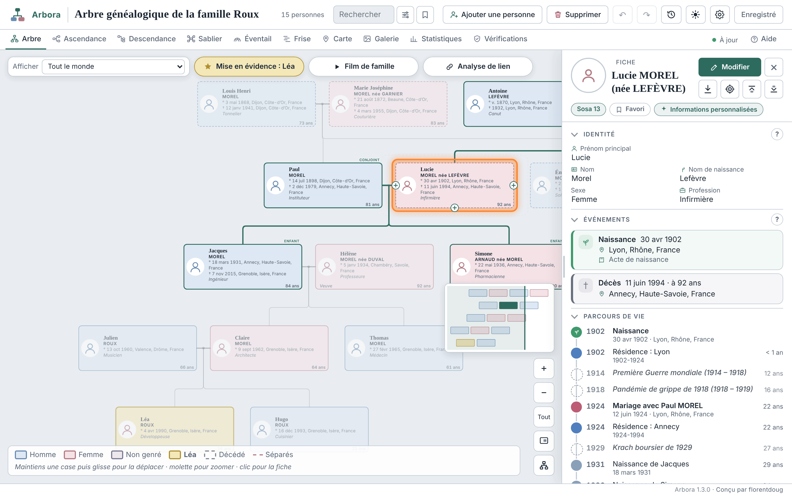</td>
    <td>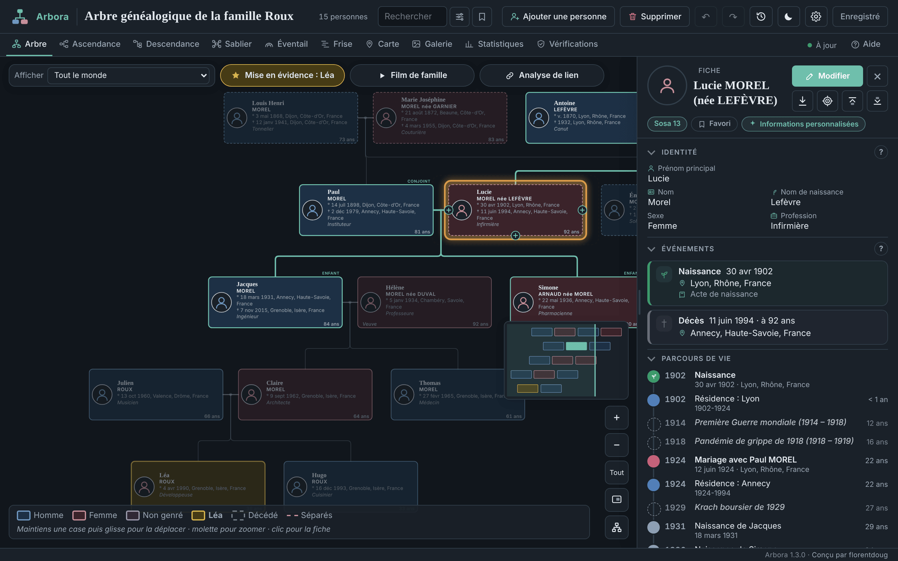</td>
  </tr>
</table>

## Démarrer en une minute

1. **Télécharge** `arbora.html` avec le bouton ci-dessus.
2. **Ouvre-le** d’un double clic, dans Chrome, Edge, Firefox ou Safari.
3. **Commence** par toi, importe un fichier GEDCOM (MyHeritage, Geneanet…), démarre avec une IA, ou explore d’abord **l’arbre d’exemple**.

Ton arbre vit dans le fichier : enregistre-le, sauvegarde-le, envoie-le à ta famille. Arbora te prévient d’une nouvelle version et **se met à jour en gardant ton arbre**.

> Sur iPhone ou iPad, les aperçus de fichiers (Fichiers, Mail, WhatsApp) n’exécutent pas le code. Utilise un ordinateur, ou la démo en ligne.

## Pourquoi Arbora

- **Tes données restent chez toi.** Rien n’est envoyé sur un serveur. Pas de publicité, pas de pistage, et tu peux protéger le fichier par mot de passe.
- **Tout dans un fichier.** L’outil, l’arbre, les photos et les documents, en environ 1 Mo plus tes images.
- **Complet.** Arbre, fiche, sablier, éventail, frise, carte, galerie, statistiques, vérifications, livre de famille en PDF.
- **Ouvert.** Import et export GEDCOM et JSON, six langues, thème clair et sombre. Ton arbre n’est jamais enfermé.
- **Durable.** Pas d’abonnement, pas d’installation. Le fichier s’ouvrira encore dans vingt ans.

## Nouveau en 1.5.0

- **Zoom à la molette plus fluide** et Carte plus rapide.
- **Visite guidée refaite pour les débutants** et nouvel écran d’accueil.
- **Vérifications remaniées** avec des « Petites victoires » et la progression par catégorie.
- **Résidences avec année de début et de fin**, triées en un clic.
- **IA** : recherche sur l’histoire d’un nom de famille, avec conseil de recherche approfondie.
- **Exporter repensé**, aperçu dans la galerie, passage guidé après une mise à jour.

## Nouveau en 1.4.0

- **Parcours d’une personne sur la carte**, avec les étapes numérotées.
- **Réordonner les résidences** en les glissant dans la fiche.
- **Mise à jour guidée** : le fichier actuel peut être remplacé directement, sinon une fenêtre explique comment passer au nouveau.
- **Numérotation Sosa** désactivable partout, **À propos** remanié, photos rondes et grandes par défaut.

## Nouveau en 1.3.0

- **Vue Sablier** : les ancêtres à gauche et les descendants à droite d’une même personne.
- **Galerie** de toutes les photos et de tous les documents, avec une planche contact en PDF.
- **Témoins, parrains et marraines**, **liens d’adoption et de famille d’accueil**.
- **Recherche dans tout le contenu**, **favoris**, **import CSV**, **calendrier républicain**, **repères historiques**.
- **Fiche PDF personnalisable** : 8 palettes, 3 mises en page, police moderne ou classique, et le contenu de ton choix.
- **Des vérifications qui guident** d’une remarque à l’autre, avec « Pourquoi ? » sur chacune.
- **Arbre d’exemple** pour tout essayer sans risque, **allègement des images** avec un aperçu réel avant et après.
- **Un fichier deux fois plus léger** : environ 1 Mo au lieu de 2,1 Mo, sans rien enlever.

Détail complet dans le [CHANGELOG](CHANGELOG.md#français).

## En images

<table>
  <tr><th width="50%">Clair</th><th width="50%">Sombre</th></tr>
  <tr><td colspan="2"><b>Sablier</b> : ancêtres et descendants d’une même personne</td></tr>
  <tr><td>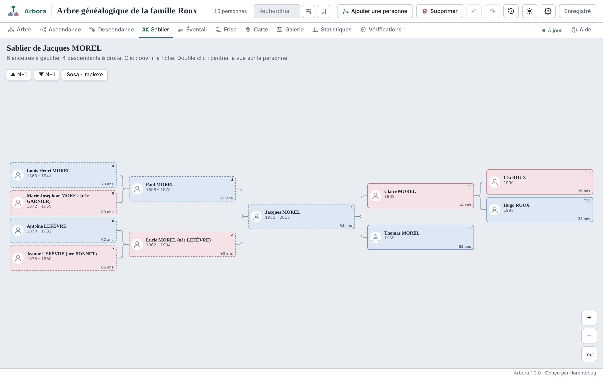</td><td>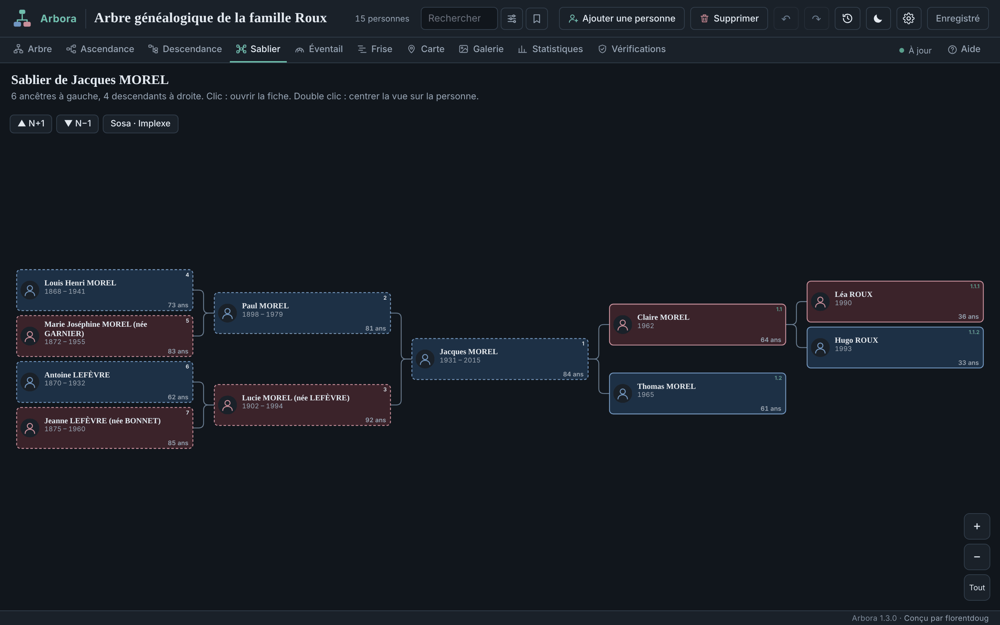</td></tr>
  <tr><td colspan="2"><b>Éventail</b> des ancêtres</td></tr>
  <tr><td>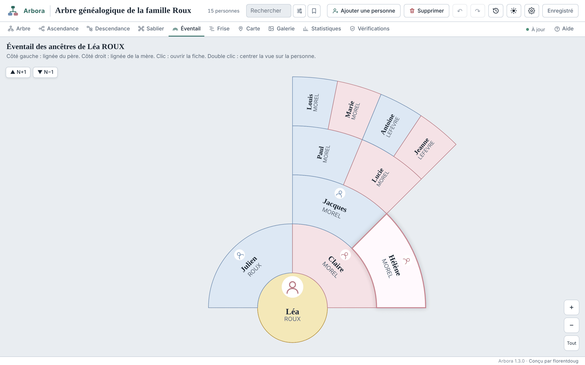</td><td>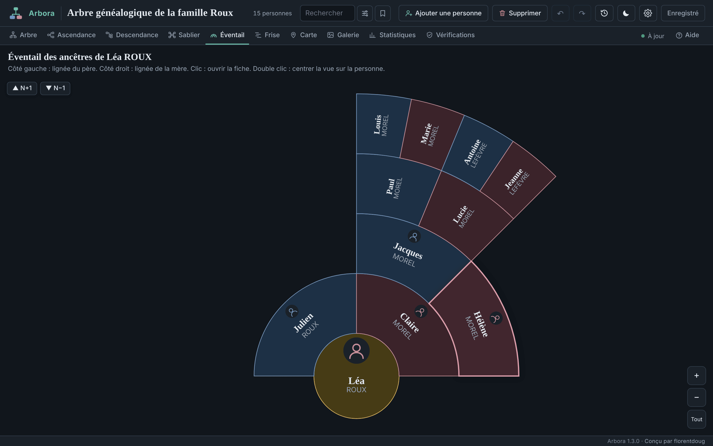</td></tr>
  <tr><td colspan="2"><b>Statistiques</b>, records et curiosités</td></tr>
  <tr><td>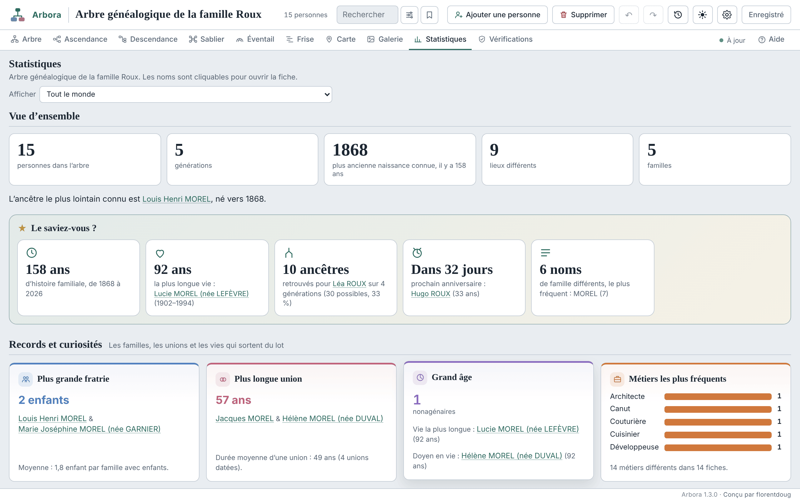</td><td>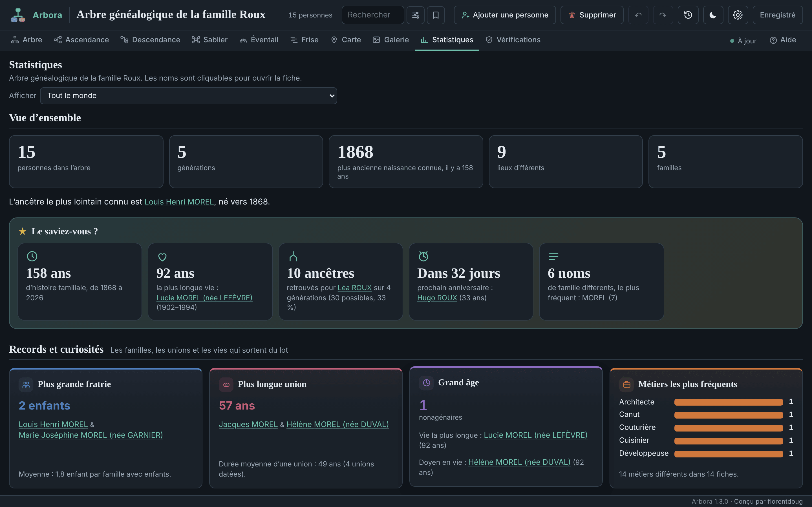</td></tr>
  <tr><td colspan="2"><b>Frise</b> des vies</td></tr>
  <tr><td>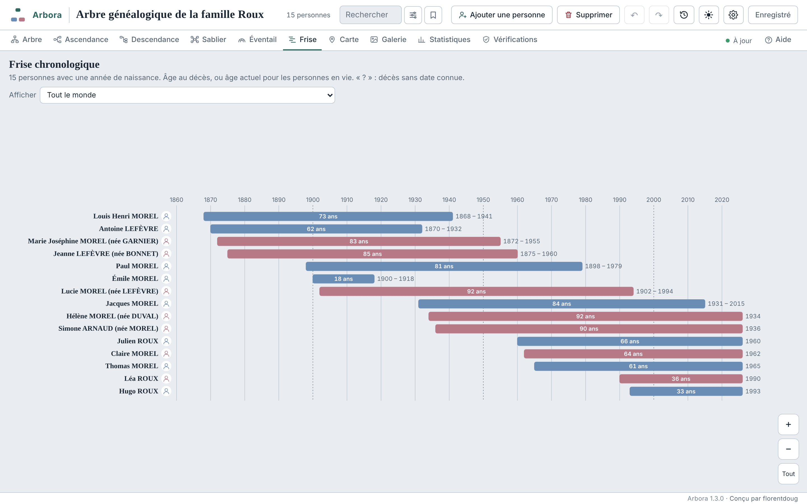</td><td></td></tr>
  <tr><td colspan="2"><b>Fiche en PDF</b>, personnalisable</td></tr>
  <tr><td>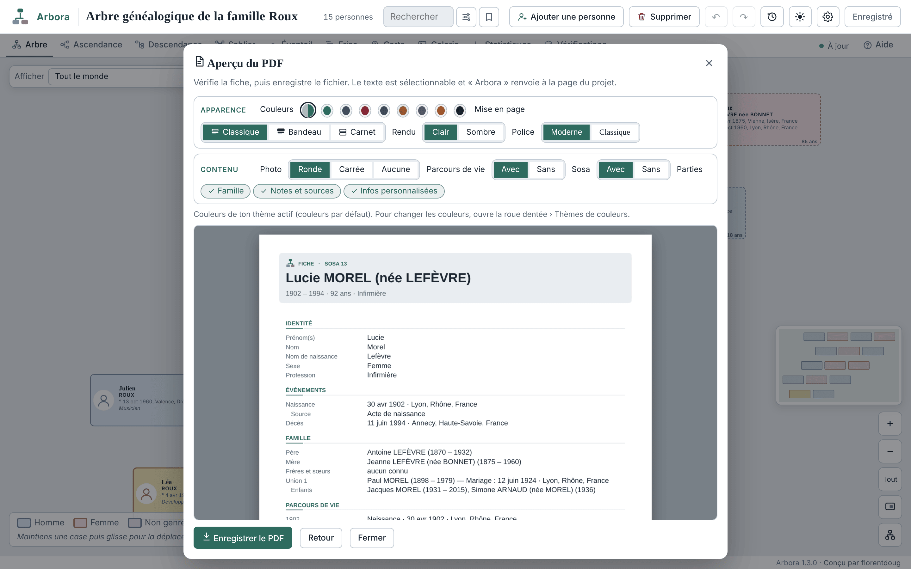</td><td>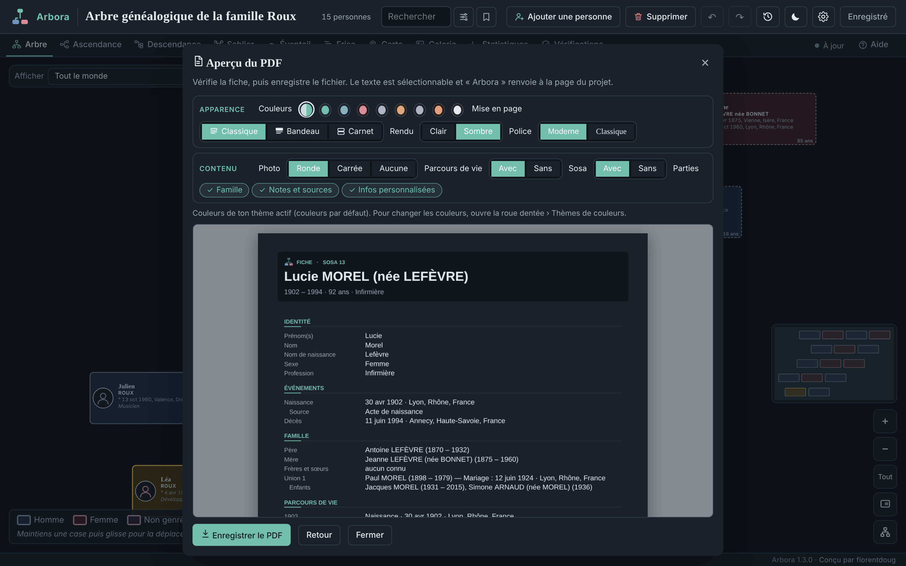</td></tr>
</table>

Les captures utilisent une famille fictive.

## Toutes les fonctions

<b>Voir la liste complète</b>

- Arbre interactif à disposition automatique, fiches détaillées (lecture ou modification) avec des icônes par champ, unions et divorces, photos et documents, photos de la vie.
- Vues ascendance, descendance, sablier (avec la numérotation d’Aboville), éventail, frise, carte et galerie.
- Parcours de vie par personne (métier, études, déménagements…) avec l’âge à chaque étape et des repères historiques au choix.
- Sources structurées avec fiabilité, témoins, parrains et marraines, liens d’adoption et de famille d’accueil.
- Numérotation Sosa, ancêtres communs et complétude par génération.
- Statistiques avec « Le saviez-vous ? », records et curiosités, un portrait pour chaque filtre, informations personnalisées, analyse de lien de parenté.
- Vérifications : dates impossibles, boucles, doublons, formats, lieux à harmoniser, pistes de recherche par pays, progression dans le temps.
- Livre de famille en PDF, fiche PDF d’une page personnalisable, planche contact de la galerie, exports image et GEDCOM.
- Film de famille animé, exportable en vidéo.
- Import GEDCOM, JSON et CSV, avec un choix clair entre fusionner et remplacer, et la fusion des doublons.
- Partage d’une fiche ou d’une famille entière : à l’import, les personnes déjà présentes sont reconnues.
- Copie partageable de l’outil (modifiable ou en lecture seule), personnes vivantes masquables.
- Protection par mot de passe, historique des modifications gardé dans le fichier, journal exportable.
- Calendrier de la famille (.ics), rappel « Aujourd’hui dans la famille », favoris, recherche avancée, raccourcis clavier (touche `?`).
- Carte avec les parcours de vie et l’actualisation de tous les lieux en un clic.
- Allègement des images avec un aperçu réel et les limites d’envoi (courriel, Discord).
- Consignes prêtes à l’emploi pour améliorer l’arbre ou le démarrer avec une IA.
- Six langues : français, anglais, espagnol, allemand, italien, portugais. Thème clair et sombre, thèmes de couleurs.

## Mettre à jour

Le bandeau de mise à jour propose **Mettre à jour en gardant mon arbre** : Arbora télécharge la nouvelle version, y place ton arbre et remplace ton fichier (Chrome, Edge, Brave) ou en enregistre un nouveau et te guide pour passer dessus. Sinon, télécharge la nouvelle version, puis dans **Paramètres, Importer**, choisis **Mettre à jour depuis une ancienne copie**. Tu peux aussi importer ta dernière sauvegarde JSON.

## À savoir

L’amélioration par une IA est la seule fonction qui fait sortir tes données : envoyer ton fichier à une IA en ligne, c’est le confier à une entreprise. Le fond de carte, la recherche de lieux (OpenStreetMap) et les polices d’écriture se chargent depuis internet quand c’est possible, sans aucune donnée de l’arbre.

## Signaler un problème ou proposer une idée

Onglet **[Issues](https://github.com/florentdoug/arbora/issues/new/choose)** ou les **[Discussions](https://github.com/florentdoug/arbora/discussions)**. Merci de ne jamais joindre de fichier contenant des données réelles de ta famille.

## Soutenir Arbora

Arbora est gratuit et le restera. Si l’outil t’est utile, tu peux offrir un café à son auteur sur **[Ko-fi](https://ko-fi.com/florentdoug)**.

## Licence

Logiciel libre sous licence **GNU GPL v3** : tu peux l’utiliser, l’étudier, le modifier et le redistribuer, à condition que les versions modifiées restent libres sous la même licence. Fourni sans garantie. Conçu par **florentdoug**.
